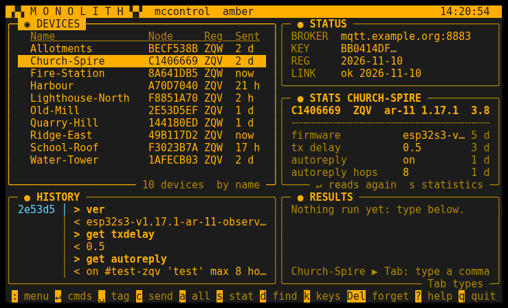
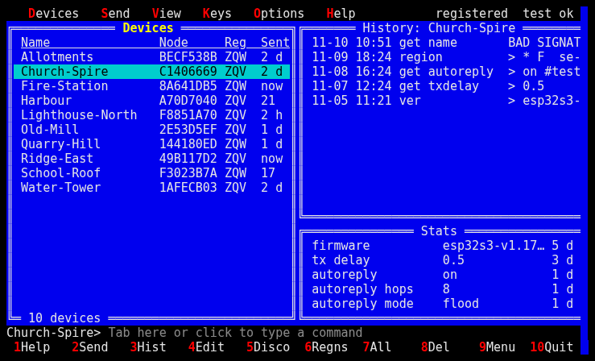
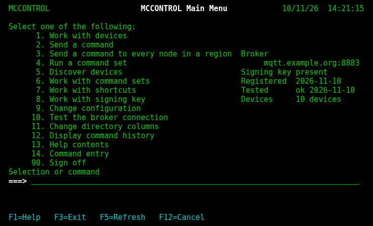
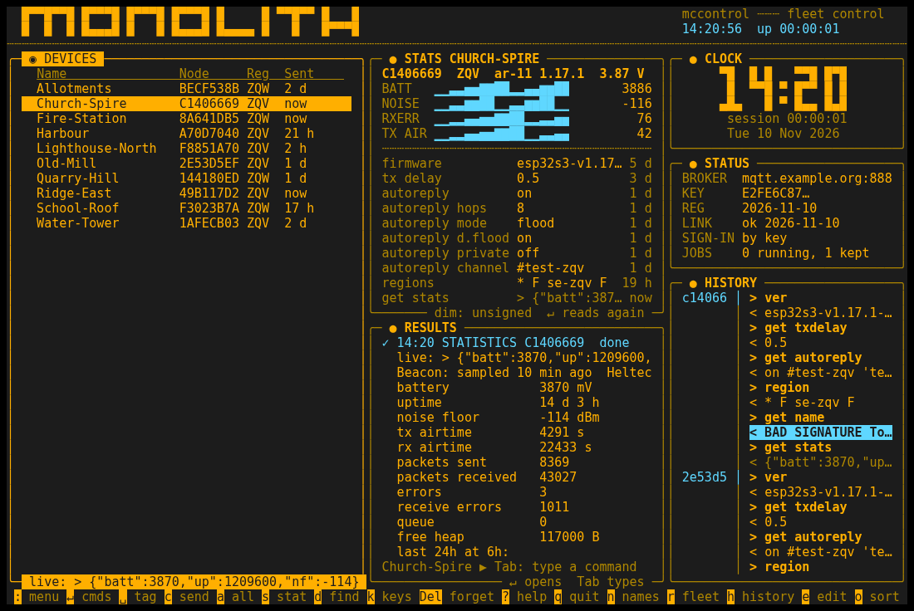
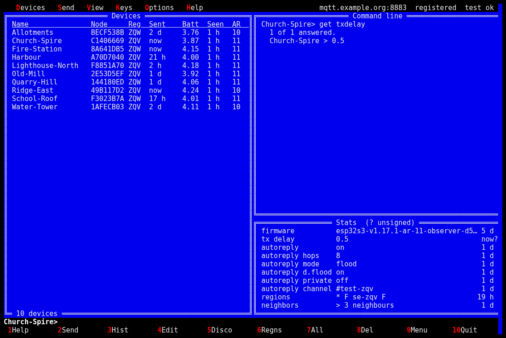
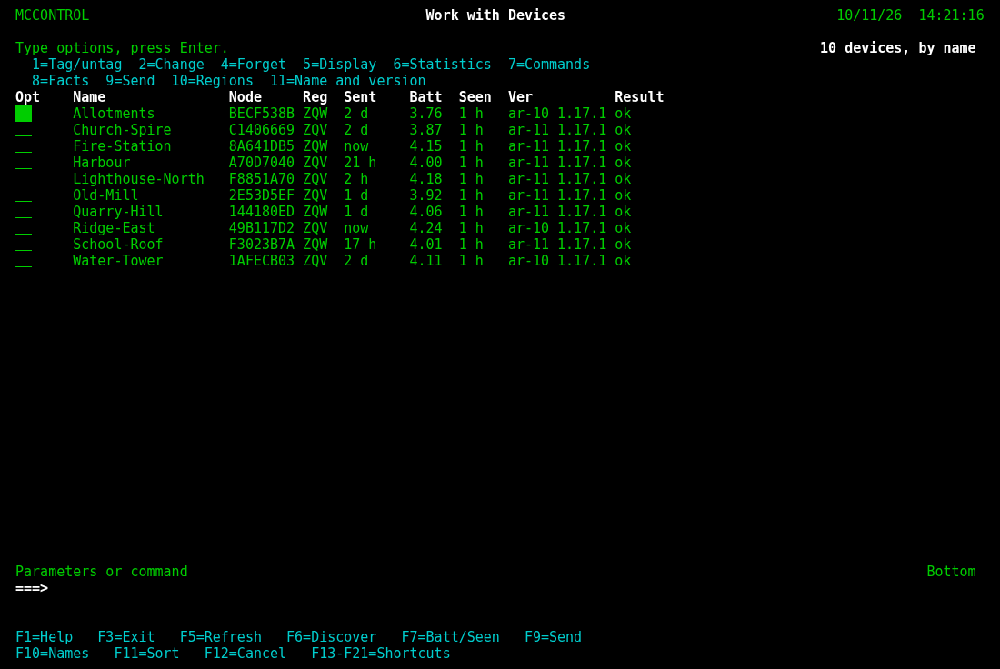

# mccontrol

For the people who run MeshCore Observer repeaters: sign a command with a key kept on your
machine, send it to one repeater, to the ones you tagged, or to every repeater in a region,
see what came back, and keep a history per device. One backend, three interfaces on it, and a
command line.

## The backend and the API

Everything the tool does -- the key, the devices, signing, the broker, Beacon, history --
sits behind a JSON API on `127.0.0.1` (`mccontrol/api/`, standard library only). Each
interface and every subcommand starts it in-process on a free port under a secret path and
talks to it through `mccontrol/apiclient.py`; nothing else of the backend is imported by them,
and `tests/test_isolation.py` fails if it is. The contract is `docs/api/openapi.json`, served
at `<base>/openapi.json`, with a Swagger page over it at `<base>/docs`. `--api <url>` sends a
subcommand to a server already running instead of starting one of its own.

## The interfaces

**[Monolith](mccontrol/ui/Monolith/README.md) is the default**: plain `mccontrol` starts it. A
board of live tiles in phosphor on black -- the directory, STATS (what is known about the cursor
device, each fact with its age), results with a command line under them, a HISTORY of what was
sent and what came back, the broker and key -- with a command palette and the mouse.

The other two do the same work in their own idiom, with the same facts, command line and
history; start one with `mccontrol --ui <name>`:

- [MeshcoreCommander](mccontrol/ui/MeshcoreCommander/README.md): Norton Commander's panels in
  Turbo Pascal colours, every verb on a function key, a DOS-style command line.
- [IBMi](mccontrol/ui/IBMi/README.md): the 5250 green screen -- numbered menus, Opt columns,
  `===>` lines, Command Entry.

Each page has the interface's screens, every key, its menus or palette, and what each pane shows.

| Monolith | MeshcoreCommander | IBMi |
|---|---|---|
| [](mccontrol/ui/Monolith/README.md) | [](mccontrol/ui/MeshcoreCommander/README.md) | [](mccontrol/ui/IBMi/README.md) |

### The three styles, full size

**Monolith**, the default: the directory, STATS with sparklines, the results of a statistics read,
the clock, status and HISTORY.

[](mccontrol/ui/Monolith/README.md)

**MeshcoreCommander**: the directory, a command sent from the command line, Stats.

[](mccontrol/ui/MeshcoreCommander/README.md)

**IBMi**: Work with Devices, with an Opt column and a `===>` line.

[](mccontrol/ui/IBMi/README.md)

Each interface's page has more screens: the command list, a send in progress, history.

The pictures are an invented fleet; `python scripts/screenshots.py` makes them again from the
code as it is (a scratch home, the fake broker and Beacon, each interface in a pseudo-terminal,
headless Chromium for the PNG).

A name given with `--ui` (`ibmi` and `IBMi` are the same) is kept in the configuration, so plain
`mccontrol` starts the last one asked for; with none asked for yet it starts Monolith (and keeps
nothing), and a kept name that is gone since starts Monolith, says so and is forgotten. A name
given that is not there lists them and exits 2. `--api <url>` runs it on a server already
running instead of starting one of its own, and that server's configuration keeps the name:

```
interfaces (mccontrol --ui <name>):
  IBMi               IBMi: the 5250 green screen -- numbered menus, Opt columns, ===> and F3/F5/F12
  MeshcoreCommander  Norton Commander panels in Turbo Pascal colours: the directory, history and every verb on a function key
  Monolith           Monolith: a retro-futuristic board of live tiles, a command palette, phosphor on black
```

Each is a package under `mccontrol/ui/<name>/` with `run(client)`, a one-line `DESCRIPTION` and
its page; a fourth one is a directory more. Without a terminal each says so and exits 2.
`tests/test_parity.py` fails when Monolith gains a verb the other two have no counterpart for.

## Install

```
pip install git+https://github.com/sweden-mesh/mccontrol   # or `pip install .` in a clone
mccontrol keygen                                  # once; prints the two serial commands
mccontrol register                                # once; the broker then checks your commands
mccontrol test                                    # connect, sign in, subscribe, publish, receive
mccontrol discover JKG --add                      # every node in JKG that accepts your key
mccontrol                                         # the screens: Monolith, or the last --ui asked for
```

Python 3.10 or newer; `pycryptodome` (Ed25519) and `paho-mqtt`; `curses` from the standard
library. 80x24 is the minimum; wider terminals get wider panels, and on a narrow one each
interface's directory-columns setting (or `mccontrol config --columns ver,result`) picks which
columns the directory shows.

## What it does

- **Keys.** An Ed25519 seed under `~/.config/mccontrol/key.seed`, mode 600, never shown and
  never leaving the machine inside anything but a signature. Each interface's key screen shows
  the two serial commands that provision a repeater, on one line, and refuses to replace a key by accident.
- **Devices.** Name, node id (the first eight hex characters of the public key, as the firmware
  names it on its topics), region (the IATA code its observers use; a person may run repeaters
  in several), notes, last sent, last result.
- **Discovery.** One harmless read signed with your key, broadcast to a region on the control
  broker. Only a node that verified the signature publishes a result, so every answer is a node
  of yours; a second read fills in names on firmware that admits `get name`.
- **Sending.** One signed publish per tagged device to its own topic, or one broadcast to a
  region; results per device as each interface shows them, kept in history; what each device
  answered is parsed into its facts (`GET /devices/{ref}/facts`).
- **Command sets.** A named list of steps (`region put`, `region allowf`, `region save`, `region`
  is the shipped example) sent in order to the targets, stopping at the first refusal or silence;
  every interface runs and defines them, as does `mccontrol run` and `mccontrol sets`.
- **Statistics.** The node's own counters first, by one signed `get stats` (firmware of
  2026-10-08 or later; older firmware answers not-allowed and the view says so), then what a
  Beacon server holds (read-only HTTP, no credentials): the status block with the sample's age
  and the telemetry history.
- **Help.** Topics with cross-links, a command reference, and the same text on the command line:
  `mccontrol help commands`.

## The command line

```
mccontrol send loutest region put se-jkp '*'
mccontrol send JKG region allowf se-jkp --all
mccontrol send loutest region --dry-run
mccontrol regions loutest
mccontrol alt 2 loutest                  # shortcut 2 (ver); mccontrol shortcuts lists and --set changes them
mccontrol run add-scope loutest se-jkp   # a command set, step by step, stopping at the first refusal; mccontrol sets lists them
mccontrol stats loutest --range 48h      # from Beacon (beacon.meshat.se by default; mccontrol config --beacon-url for another)
mccontrol fleet                          # the directory with Batt and Seen refreshed from Beacon
mccontrol refresh [device...]            # get name and ver over the control plane; names the unnamed
mccontrol reads loutest                  # what it last answered to each read, with the age
mccontrol commands [device]              # the command table; with a device, what its firmware lacks is marked
mccontrol history loutest                # a forged reply says BAD SIGNATURE, an unsigned one (unsigned)
mccontrol devices | add | remove | discover | key | keygen | config | test | help
```

## Setting up a repeater

Two lines over its serial console, on the firmware of 2026-10-08 or later (ar-11):

```
set mqtt.cmd.pubkey <your 64-hex public key>     # mccontrol key prints it
set mqtt.cmd on                                  # takes a free slot, points it at mqtt.louie.se; reboot
```

The node answers `OK - slot 3, mccontrol (mqtts://mqtt.louie.se:8883), packets off; reboot to
apply`. A board without PSRAM runs two MQTT slots at once; with both analyzer uplinks up it
says so and asks you to turn one off (`set mqtt2.preset none`) rather than doing it for you.
Then `mccontrol register` once per key, so the broker checks your commands before they fan out.

## Signing in

With no username configured, the tool signs in to the broker the way a node does: the
username is `v1_` plus its public key, the password a token signed by its key
(`mccontrol/token.py`, the firmware's own JWT shape byte for byte), renewed each session.
Nothing is handed out or typed; the key is the identity, and that is how the default broker
`mqtt.louie.se` knows who publishes. A login from the broker's password file sets its username
and password, and those are used instead.

## The configuration is the control broker

The only thing configured is the control broker: host (default `mqtt.louie.se`, the broker a
node's `mqtt.cmd.slot` points at), port, username, password and how long to wait for answers.
The full feature set needs the broker to run the mcbroker Mosquitto plugin. A region belongs to
a device, not to the configuration.

```
~/.config/mccontrol/
    key.seed            your private seed, mode 600
    config.json         the control broker and how long to wait
    devices.json        your devices, each with its region
    history/<node>.jsonl
```

`MCCONTROL_HOME` keeps them elsewhere.

## The protocol

The envelope is the one the Observer auto-reply firmware verifies (`src/helpers/MqttControlLogic.h`
there): the node's topic is named by its whole 64-hex key from firmware ar-11 and by the first
8 hex before that -- the tool keeps the key per device and addresses each by the form its
firmware uses, showing the 8-hex id as the name; `v1|counter|expiry|command|signature`, signed over the topic and the body together, so a
command captured from one node cannot be replayed at another. The node checks the signature,
that the counter is higher than the last it accepted, the expiry, its rate limit, and a deny
list of commands (since 2026-10-08 everything the console answers travels except identity, the
control plane's own settings, credentials, the destructive group, position and role, the radio,
transmissions and the clock step; `mccontrol help commands` has it, and `mccontrol/denylist.py`
mirrors it so a refusal is explained before signing); a result is published only when the
signature verified. A region tree
line (`region def a|* b|*`) cannot travel: `|` is the field separator; `region put` one name at
a time does the same job. `mccontrol help protocol` has the rest.

What that buys, and what it does not: no one on the broker can alter a field, move a command
to another node or region, turn it into a broadcast, or replay it at a node that has seen it;
a captured envelope can run once at most, and only within its life. The broker can still
drop or delay a command and read everything. A result from firmware ar-11 or later is signed by
the node and shown `[signed]`; a forged one shows as BAD SIGNATURE and is ignored; an unsigned
`r1` from older firmware is shown as is -- confirm those with a read rather than with the `ok`. Each property is a test
in `tests/test_envelope.py`; `mccontrol help assurance` is the argument in full.

## Tests

`pytest` runs the unit tests, the API against its OpenAPI document, the isolation test, and
pseudo-terminal walks of each interface against a scripted transport (`MCCONTROL_FAKE_RESULTS`):
every function key, option and verb pressed once, on an 80x24 and a wider terminal.
`tests/test_parity.py` holds MeshcoreCommander and IBMi to Monolith's verbs, and
`tests/test_pages.py` the pages' links and keys to the code.

`python scripts/screenshots.py` remakes `docs/screenshots/` from an invented fleet (it needs
headless Chromium; `--only <name>` for one picture, `--keep-html` to keep the pages it renders).
