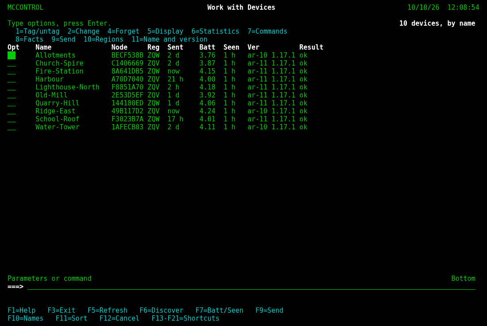
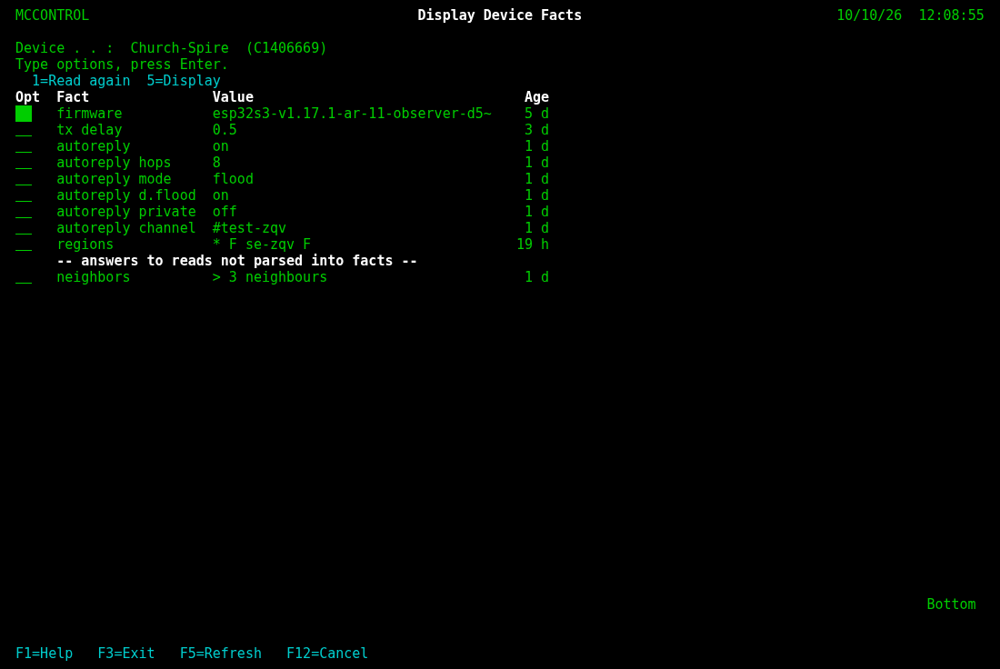
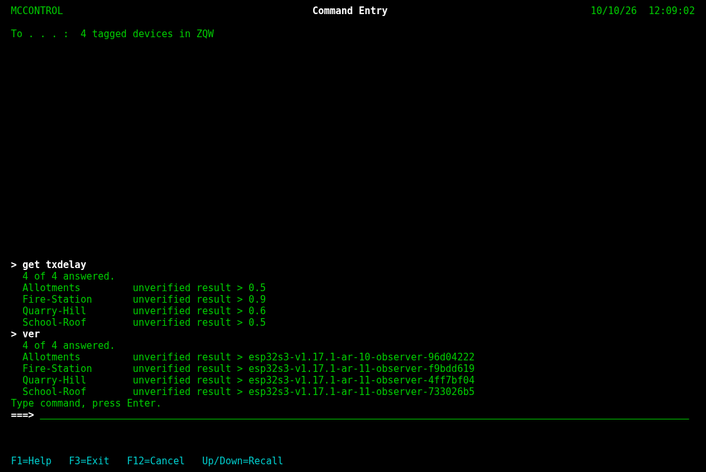
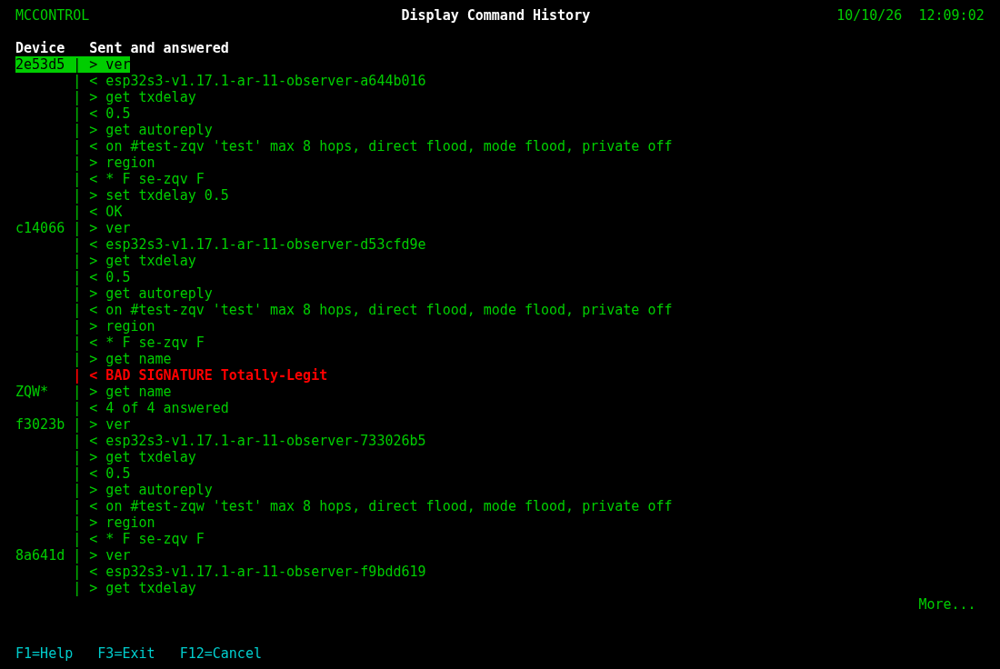
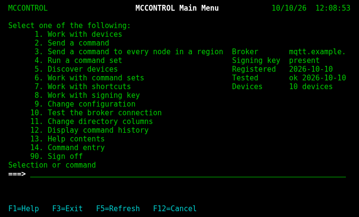

# IBMi

The IBM i (AS/400, 5250) green screen: a numbered main menu, lists with an Opt column, a `===>`
command line on every screen, the message line above the function keys. One of mccontrol's three
interfaces; [Monolith](../Monolith/README.md) is the default, and this one does the same work
(`mccontrol --ui IBMi`, or `ibmi`; the name is then kept, so plain `mccontrol` starts it next
time). Back to the [main README](../../../README.md).



| | |
|---|---|
|  |  |
|  |  |

The pictures are an invented fleet, made by `scripts/screenshots.py`. As text, the main menu:

```
 MCCONTROL                    MCCONTROL Main Menu            10/10/26  09:00:00

 Select one of the following:
       1. Work with devices
       2. Send a command
       3. Send a command to every node in a region  Broker
       4. Run a command set                                 mqtt.louie.se:8883
       5. Discover devices                          Signing key present
       6. Work with command sets                    Registered  no - select 8
       7. Work with shortcuts                       Tested      no - select 10
       8. Work with signing key                     Devices     3 devices
       9. Change configuration
      10. Test the broker connection
      11. Change directory columns
      12. Display command history
      13. Help contents
      14. Command entry
      90. Sign off
 Selection or command
 ===>


 F1=Help   F3=Exit   F5=Refresh   F12=Cancel
```

## The main menu

A number on `===>` opens that screen; `90`, `signoff` or `quit` signs off. `1` Work with devices,
`2` Send a command, `3` to every node in a region, `4` Run a command set, `5` Discover, `6` Work
with command sets, `7` Work with shortcuts, `8` Work with signing key, `9` Change configuration
(the broker, its port, TLS on or off, credentials, the Beacon URL), `10` Test the broker
connection, `11` Change directory columns, `12` Display command history, `13` Help contents, `14`
Command entry. At the right: the broker, the signing key, when it was registered, the last broker
test kept for this broker (`ok 2026-10-10`, or `no - select 10`), the devices.

## Work with Devices

The directory with an Opt column: type an option on one or more rows and press Enter.

| Opt | does |
|---|---|
| 1=Tag/untag | tag the row (a ">" before it marks it); the other options and F9 act on the tagged rows, or the cursor row |
| 2=Change | name, region, notes |
| 4=Forget | after a Confirm screen; its history file stays |
| 5=Display | the device and its history, newest first; 5 on an entry shows it whole |
| 6=Statistics | `get stats` live, then what Beacon holds; F10 and F11 widen it to 48 hours and 7 days |
| 7=Commands | every command, by group, what the firmware does not admit grey with the build it needs; 1 asks the parameter and sends |
| 8=Facts | Display Device Facts: what is known about the device -- tx, rx and direct tx delay, autoreply and its settings, regions, firmware, name, every other `get` -- each with its age, "unsigned" where older firmware answered; then the reads not parsed, raw. 1 reads again, 5 shows one whole |
| 9=Send | the Send a Command prompt for those rows |
| 10=Regions | read the region map (`region`) |
| 11=Name and version | `get name` and `ver`; an unnamed device takes the fleet's name |

## Function keys

F1 help for the screen, F3 exit, F5 refresh, F12 cancel everywhere. On Work with Devices: F6
discover, F7 Batt and Seen from Beacon, F9 send, F10 names and versions, F11 the next sort,
F13-F21 (Shift+F1-F9, or Alt+1..9) the shortcuts. Elsewhere: F4 on Send a Command prompts the
command from the list, F6 adds every found device on Work with Found Devices and creates a set on
Work with Command Sets, F10 on Change Configuration saves and tests.

## Commands on `===>`

`send <device> <command>`, `all <region> <command>`, `discover <region>`, `run <set> [arg]`,
`alt <n>`, `names`, `fleet`, `tag <region>`, `untag`, `invert`, `sort <by>`, `devices`, `cmd`,
`history`, `help [topic]`. On Work with Devices they act on the tagged rows or the cursor row,
and `stats [24h|48h|168h]` is added.

## Command Entry

`14`, or `cmd` on any `===>`: the 5250's own Command Entry display. A command typed on its
`===>` goes to the tagged devices -- from Work with Devices, to the rows it acts on -- and what
came back scrolls up above the line, with each answer's signature, for the session. A command
that takes something away gets its Confirm screen first; one the node would refuse is said on a
line of its own and not sent. Up and Down recall; F3 leaves.

```
 MCCONTROL                       Command Entry               10/10/26  09:00:00

 To . . . :  Gisebo  (4AC61A7F, JKG)


 > ver
   1 of 1 answered.
   Gisebo             unverified result > esp32s3-v1.17.1-ar-11-observer-90e86c
 > get name
   1 of 1 answered.
   Gisebo             unverified result > SE-JKG-Gisebo
 Type command, press Enter.
 ===>


 F1=Help   F3=Exit   F12=Cancel   Up/Down=Recall
```

## Display Command History

`12`, or `history`: per device its last six commands and what came back, newest block first,
in the operator's form

```
65c1d1 | > get ver
       | < louie-magic-fw-1.2
       | > get tx.delay
       | < 0.5
JKG*   | > get name
       | < 2 of 2 answered
```

A region broadcast is a block of its own (`JKG*`); a reply whose signature failed reads
`BAD SIGNATURE <reply>`, one from older firmware `(unsigned)`.

Every wait shows its progress and the seconds waited on the message line; F12 or Esc stops
waiting and keeps what came. Help (F1) explains each screen; F11 in help shows the contents.
