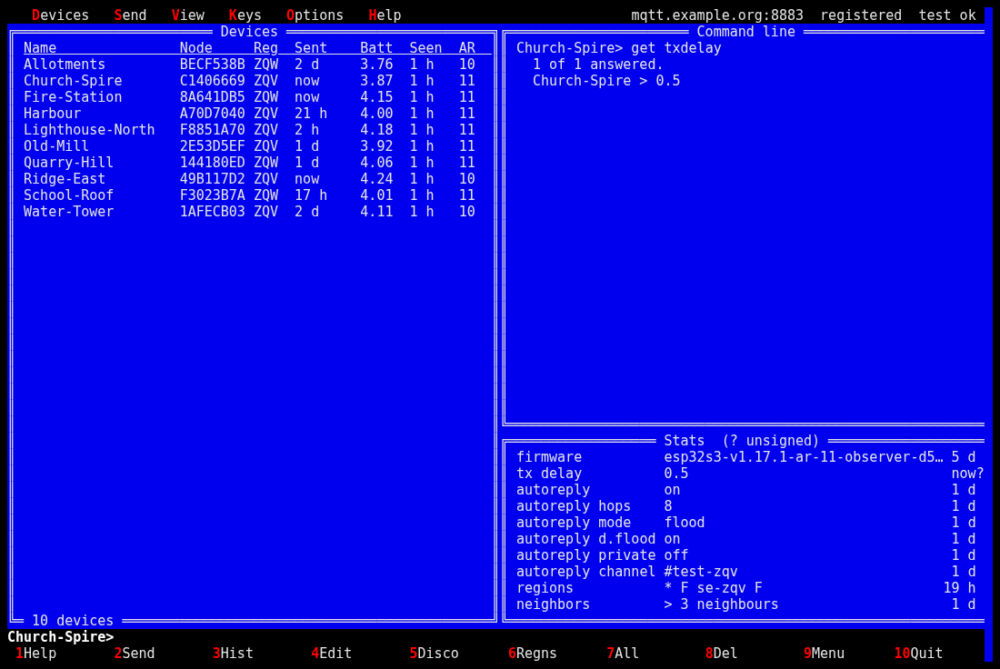
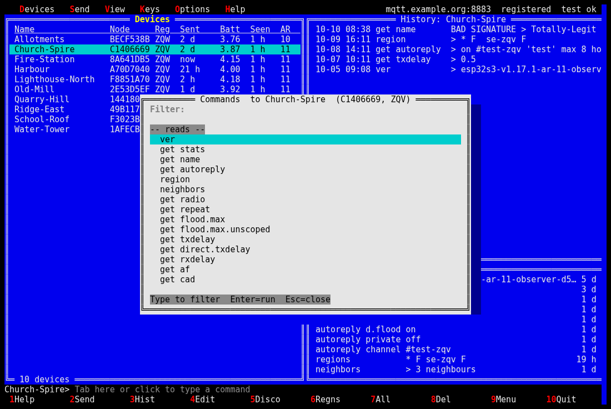
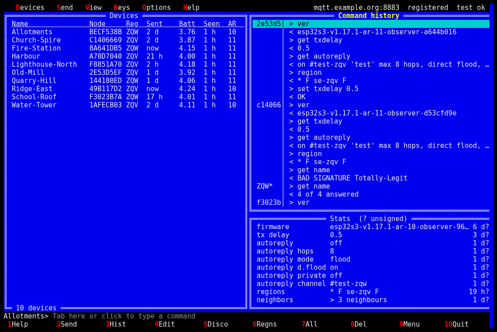
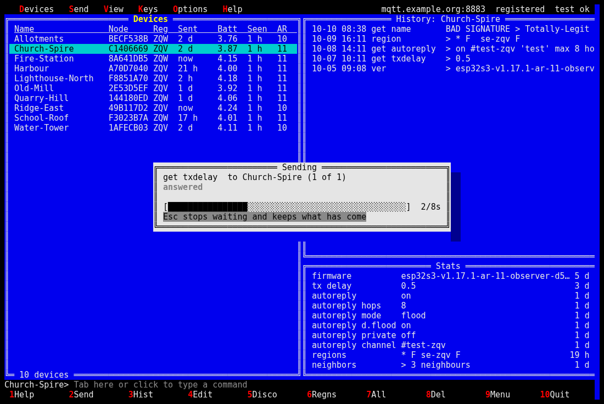
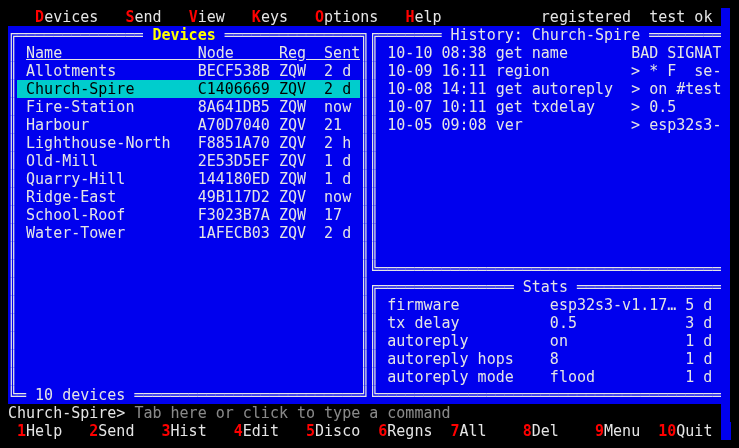

# MeshcoreCommander

Norton Commander's panels in Turbo Pascal's colours: the device directory on the left, what the
cursor is on to the right, every verb on a function key, a DOS-style command line above the key
bar. One of mccontrol's three interfaces; [Monolith](../Monolith/README.md) is the default, and
this one does the same work (`mccontrol --ui MeshcoreCommander`; the name is then kept, so plain
`mccontrol` starts it next time). Back to the [main README](../../../README.md).



| | |
|---|---|
|  |  |
|  |  |

The pictures are an invented fleet, made by `scripts/screenshots.py`. As text, at 80x24:

```
   Devices   Send   View   Keys   Options   Help
╔══════════════ Devices ═══════════════╗╔════════════ Command line ════════════
║ Name               Node     Reg  Sent║║ Gisebo> get txdelay
║ Far                FD700369 GOT  -   ║║   1 of 1 answered.
║ Gisebo             4AC61A7F JKG  now ║║   Gisebo       > 0.5
║ (unnamed)          65C1D12C JKG  -   ║║
║                                      ║║
║                                      ║║
║                                      ║║
║                                      ║║
║                                      ║║
║                                      ║║
║                                      ║║
║                                      ║║
║                                      ║╚══════════════════════════════════════
║                                      ║╔════════ Stats  (? unsigned) ═════════
║                                      ║║ tx delay 0.5                     now?
║                                      ║║ regions  * F                     3 d?
║                                      ║║
║                                      ║║
║                                      ║║
╚═ 3 devices ══════════════════════════╝╚══════════════════════════════════════
Gisebo> Tab here or click to type a command
 1Help   2Send   3Hist   4Edit   5Disco  6Regns  7All    8Del    9Menu  10Quit
```

Right of the menu bar, where Norton Commander kept its clock: the broker, whether your key is
registered with it, and the last broker test kept for that broker (`test ok`, `test FAILED`,
`untested`); the broker drops out first on a narrow terminal.

The colours are Turbo Pascal's: a black menu bar and key bar with the hot letters and key
numbers in red, a blue work area, grey dialogs, green for the open menu. A terminal without
colour gets bold and reverse video instead. 80x24 is the minimum; a wider terminal gets wider
panels.

## The panels

- **Devices** (left): your device directory -- name, node id, region, last sent, and Batt, Seen,
  Ver and Result once asked for (Options > Directory columns picks which fit). Ins or Space tags
  a row, `*` inverts, `+`/`-` tag or untag a region; the bottom edge counts the tags. A name
  ending in ` ?` is a device nothing has been heard from for seven days after a send -- over the
  control plane or by Beacon -- a device to look at, not a verdict.
- **The right panel** follows the cursor: the device's history, newest first. After a send it
  shows that send's results, after a discovery what answered (Ins tags, F5 adds the tagged, F7
  adds all, Esc returns); `h` shows every device's command history in blocks, newest first --
  `65c1d1│ > get ver`, `      │ < 1.2` -- with BAD SIGNATURE on a forged reply and (unsigned)
  after one from older firmware; and the command line's console lands here. Enter opens a line
  whole.
- **Stats** (lower right): what is known about the cursor device -- tx, rx and direct tx delay,
  autoreply and its settings, regions, firmware, name, every other `get` it answered -- each with
  its age, and a question mark after the age where older firmware answered unsigned. Parsed from the last
  answer to each read and every command's reply, so it changes the moment a result lands; a
  forged answer teaches nothing. Enter on a line reads it again.
- **The command line** above the key bar, as Norton Commander kept its DOS prompt: it names
  where it sends (`Gisebo>`, `2 tagged>`). Tab to it (after the three panels) or click it, type
  a command, Enter sends it as F2 would -- the tagged devices or the cursor one, a command that
  takes something away confirmed first -- and the answers, or why nothing was sent, scroll up in
  the right panel. Up and Down recall what was sent; Esc leaves.

Nothing refreshes by itself: `s`, `r` and `n` ask when you do. Every wait is a box with the
running count and a bar; Esc stops waiting and keeps what came. What an action came to is a
window, closed with Enter.

## Keys

| key | does |
|---|---|
| F1 | help for where you are; Shift+F1 the contents; links are followed with Enter, Backspace or Alt+F1 goes back |
| F2 | send a command to the tagged devices, or the cursor device; Up recalls earlier commands |
| Enter | the command list for the cursor device, by group, type to filter; a command's parameter is asked for as radio buttons, checkboxes or a text field with examples, and the reply opens when it arrives. Commands the device's firmware does not admit are grey and skipped (`mccontrol/firmware.py` knows what each build admits; an unknown version counts as the oldest) |
| F3 | the cursor device's history as a window; on the right panel, Enter opens a reply |
| F4 | edit the device: name, region, notes |
| F5 | discover: the repeaters in a region that accept your key (`JKG, GOT` for several, `*` for every region you have); on the found list, F5 adds the tagged and F7 adds all |
| F6 | read the cursor device's region map |
| F7 | send a command to every node in a region |
| F8 | forget the cursor device |
| F9 / F10 | the menu / quit |
| Options > Broker | the control broker: host, port, TLS on or off, credentials |
| Alt+1..9 | a command per key to the tagged or cursor device, no dialog: `region`, `ver`, `get name`, `get autoreply`, `get radio`, `get repeat` as shipped; Options > Shortcuts edits them |
| Ins, Space, `*`, `+`, `-` | tag a row, invert, tag or untag a region |
| Tab | cycle the three panels -- devices, history, stats (Enter there reads it again) -- then the command line (Up/Down recall, Esc leaves) |
| `n` | read `get name` and `ver` from the tagged or cursor devices: an unnamed device takes the fleet's name, the Ver column fills (sortable) |
| `r` | refresh the directory's Batt and Seen columns from Beacon for the tagged devices, or all; never automatic |
| `s` | the cursor device's statistics from Beacon (battery, uptime, noise floor, airtime, packets, errors, with the sample's age, and 24 h of history); View menu for 48 h and 7 d |
| mouse | optional: click a row, a key-bar label or a menu title |
| `h` (or View > Command history) | every device's command history in the right panel |

## The menus

F9, or Alt and the title's first letter:

- **Devices**: Discover, Edit, Forget, sort by name, region, last sent or version, Names and
  versions, Tag all in region, Untag region, Clear tags.
- **Send**: to the tagged or cursor device, to all in a region, Read regions, Command set, and
  each shortcut with its Alt key.
- **View**: Statistics, Last 48 hours, Last 7 days, Refresh Batt/Seen, Command history, Command
  line output.
- **Keys**: Show public key -- the provisioning lines, Register, Replace key; create or import
  one when there is none.
- **Options**: Broker (host, port, TLS on or off, credentials), Test the broker, Shortcuts,
  Command sets, Directory columns.
- **Help**: Contents, This screen, Keys, Commands, Quit.

Commands that take something away (`region denyf *`, `region remove`, `set repeat off`, ...)
say what they do and ask first; a command that transmits is refused as a broadcast, as the
firmware refuses it. Help (F1) explains each screen and dialog; `mccontrol help keys` prints the
shared topics.
