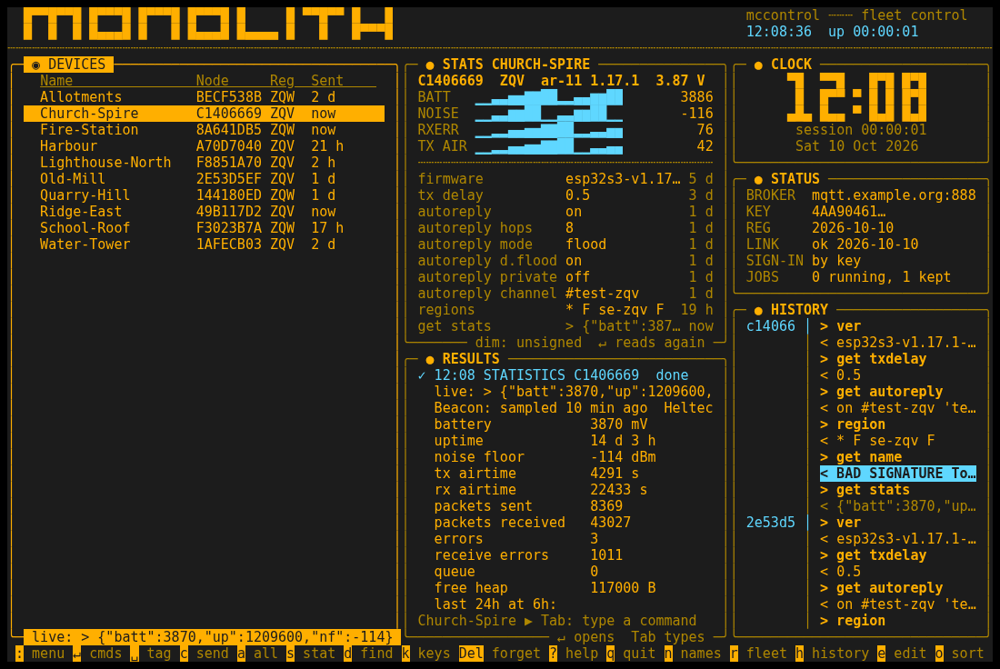
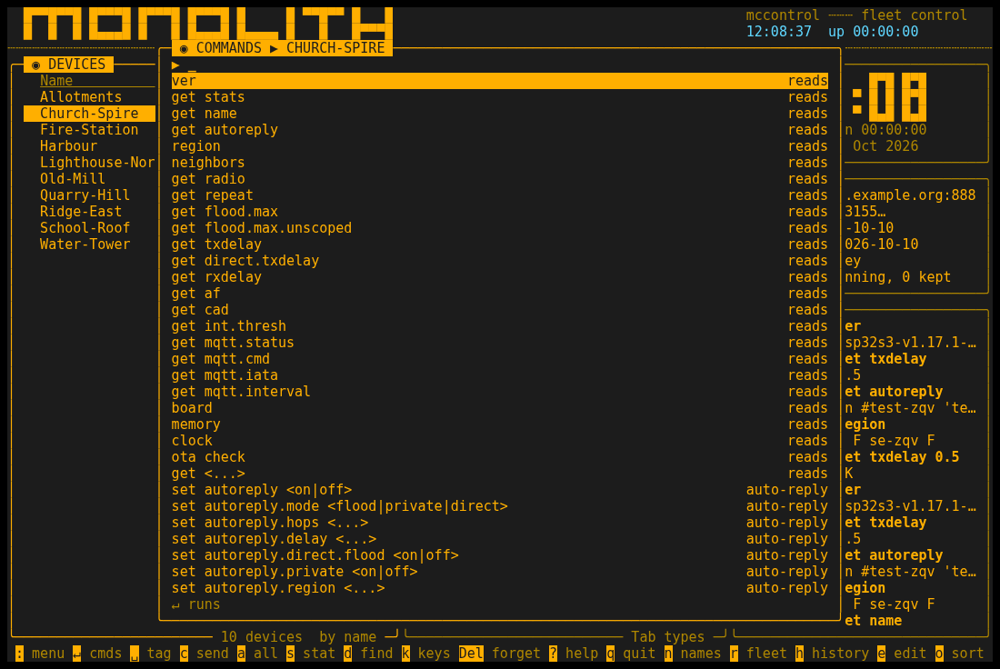
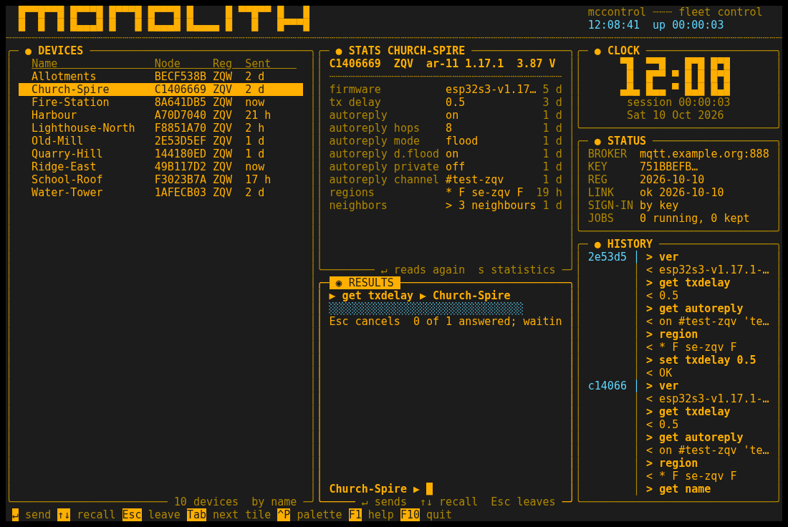
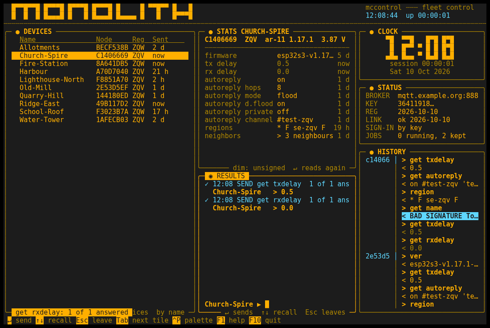
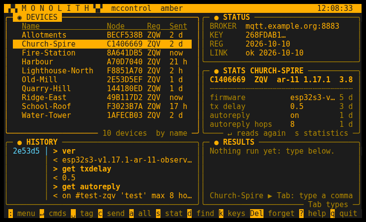

# Monolith

The default interface: the fleet as a board of live tiles in phosphor on black (amber or green),
a command palette, a command line, the mouse, jobs drawn as bars. Plain `mccontrol` starts it
until another interface is asked for (`mccontrol --ui Monolith` names it). The other two,
[MeshcoreCommander](../MeshcoreCommander/README.md) and [IBMi](../IBMi/README.md), do the same
work in their own idiom. Back to the [main README](../../../README.md).



| | |
|---|---|
|  |  |
|  |  |

The pictures are an invented fleet, made by `scripts/screenshots.py`. As text, at 80x24, the minimum:

```
 ▞▚ M O N O L I T H ▚▞  mccontrol  amber                              00:15:57
╭─ ◉ DEVICES ──────────────────────────────╮╭─ ● STATUS ───────────────────────╮
│   Name               Node     Reg  Sent  ││ BROKER  mqtt.louie.se:8883       │
│   Far                FD700369 GOT  -     ││ KEY     2A6A1C1E…                │
│   Gisebo             4AC61A7F JKG  -     ││ REG     no  :register            │
│   (unnamed)          65C1D12C JKG  -     ││ LINK    untested  :test          │
│                                          │╰──────────────────────────────────╯
│                                          │╭─ ● STATS GISEBO ─────────────────╮
│                                          ││ 4AC61A7F  JKG  ver ?             │
│                                          ││ ┄┄┄┄┄┄┄┄┄┄┄┄┄┄┄┄┄┄┄┄┄┄┄┄┄┄┄┄┄┄┄┄ │
│                                          ││ tx delay          0.7        2 d │
│                                          ││ autoreply         on         3 d │
│                                          ││ autoreply hops    8          3 d │
│                                          ││ autoreply mode    flood      3 d │
╰───────────────────── 3 devices  by name ─╯╰─── dim: unsigned  ↵ reads again ─╯
╭─ ● HISTORY ──────────────────────────────╮╭─ ● RESULTS ──────────────────────╮
│ 65c1d1 │ > get ver                       ││ Nothing run yet: type below.     │
│        │ < louie-magic-fw-1.2            ││                                  │
│        │ > get tx.delay                  ││                                  │
│        │ < 0.5                           ││                                  │
│ 4ac61a │ > region                        ││                                  │
│        │ < * F                           ││ Gisebo ▶ Tab: type a command     │
╰──────────────────────────────────────────╯╰────────────────────── Tab types ─╯
 : menu ↵ cmds ␣ tag c send a all s stat d find k keys Del forget ? help q quit
```

From 120 columns a third column holds a clock, the status and the history; from 40 rows the
header is the block-letter title:

```
  █▀▀█▀▀█ █▀▀▀█ █▀▀▀█ █▀▀▀█ █     █ ▀▀█▀▀ █   █                                           mccontrol ┄┄┄ fleet control
  █  █  █ █▄▄▄█ █   █ █▄▄▄█ █▄▄▄▄ █   █   █▀▀▀█                                           00:15:57  up 00:15:57
┄┄┄┄┄┄┄┄┄┄┄┄┄┄┄┄┄┄┄┄┄┄┄┄┄┄┄┄┄┄┄┄┄┄┄┄┄┄┄┄┄┄┄┄┄┄┄┄┄┄┄┄┄┄┄┄┄┄┄┄┄┄┄┄┄┄┄┄┄┄┄┄┄┄┄┄┄┄┄┄┄┄┄┄┄┄┄┄┄┄┄┄┄┄┄┄┄┄┄┄┄┄┄┄┄┄┄┄┄┄┄┄┄┄┄┄┄┄┄┄
╭─ ◉ DEVICES ──────────────────────────────────╮╭─ ● STATS GISEBO ─────────────────────╮╭─ ● CLOCK ────────────────────╮
│   Name               Node     Reg  Sent      ││ 4AC61A7F  JKG  ver ?                 ││      ▀█  ▀█    ▀▀█ ▀▀█       │
│   Far                FD700369 GOT  -         ││ ┄┄┄┄┄┄┄┄┄┄┄┄┄┄┄┄┄┄┄┄┄┄┄┄┄┄┄┄┄┄┄┄┄┄┄┄ ││       █   █  ▀  ▀█ █▀▀       │
│   Gisebo             4AC61A7F JKG  -         ││ tx delay          0.7            2 d ││      ▄█▄ ▄█▄ ▀ ▄▄█ █▄▄       │
│   (unnamed)          65C1D12C JKG  -         ││ autoreply         on             3 d ││       session 00:15:57       │
│                                              ││ autoreply hops    8              3 d ││       Sat 10 Oct 2026        │
│                                              ││ autoreply mode    flood          3 d │╰──────────────────────────────╯
│                                              ││ autoreply d.flood on             3 d │╭─ ● STATUS ───────────────────╮
│                                              ││ autoreply private off            3 d ││ BROKER  mqtt.louie.se:8883   │
│                                              ││ autoreply channel #test-jkg      3 d ││ KEY     2A6A1C1E…            │
│                                              ││ regions           * F            3 d ││ REG     no  :register        │
│                                              ││ neighbors         > 2 neighbours 3 d ││ LINK    untested  :test      │
│                                              ││                                      ││ SIGN-IN by key               │
│                                              ││                                      ││ JOBS    0 running, 0 kept    │
│                                              ││                                      │╰──────────────────────────────╯
│                                              ││                                      │╭─ ● HISTORY ──────────────────╮
│                                              ││                                      ││ 65c1d1 │ > get ver           │
│                                              │╰─────── dim: unsigned  ↵ reads again ─╯│        │ < louie-magic-fw-1… │
│                                              │╭─ ● RESULTS ──────────────────────────╮│        │ > get tx.delay      │
│                                              ││ Nothing run yet: type below.         ││        │ < 0.5               │
│                                              ││                                      ││ 4ac61a │ > region            │
│                                              ││                                      ││        │ < * F               │
│                                              ││                                      ││        │ > set txdelay 0.7   │
│                                              ││                                      ││        │ < OK                │
│                                              ││                                      ││ JKG*   │ > get name          │
│                                              ││                                      ││        │ < 2 of 2 answered   │
│                                              ││                                      ││ fd7003 │ > set txdelay 9     │
│                                              ││                                      ││        │ < refused not-allo… │
│                                              ││                                      ││                              │
│                                              ││                                      ││                              │
│                                              ││                                      ││                              │
│                                              ││                                      ││                              │
│                                              ││                                      ││                              │
│                                              ││                                      ││                              │
│                                              ││ Gisebo ▶ Tab: type a command         ││                              │
╰───────────────────────── 3 devices  by name ─╯╰────────────────────────── Tab types ─╯╰──────────────────────────────╯
 : menu ↵ cmds ␣ tag c send a all s stat d find k keys Del forget ? help q quit n names r fleet h history e edit o sort
```

## The tiles

- **DEVICES**: your device directory -- name, node id, region, last sent, and Batt, Seen, Ver
  and Result once asked for (the palette's "directory columns" picks which fit). The row under
  the cursor is the current device; Space or Ins tags it, `*` inverts, `+`/`-` tag or untag a
  region. A name ending in ` ?` is a device nothing has been heard from for seven days after a
  send, a device to look at, not a verdict.
- **STATS** follows the cursor: the node, region and version, its statistics as sparklines once
  read (`s`), and what is known about it -- tx, rx and direct tx delay, autoreply and its hops,
  mode, channel, slots or delay, regions, firmware, name, and every other `get` it has answered
  -- each with its age. Parsed from the last answer to each read and every command's reply
  (`set txdelay 0.7` answered OK is a tx delay of 0.7), so it changes the moment a result lands.
  A reply with a bad signature teaches nothing; an unsigned one (older firmware) counts but is
  drawn dim and marked unsigned. A read it cannot parse is listed raw. Enter on a row reads it
  again. The API serves the same as `GET /devices/{ref}/facts`.
- **RESULTS** is a console: each send, set and discovery as it lands, oldest at the top and the
  newest just above its command line, the running job inline as a bar; a long result shows its
  start. Enter on a result opens it whole.
- **The command line** is the bottom row of RESULTS. Tab to it (or click it), type a command,
  Enter sends it to the tagged devices or the cursor device -- the same target and caution
  confirm as `c` -- and the replies scroll up above it as they arrive. A refusal is said there,
  on a line of its own. Up/Down recall, Esc leaves; every key is text there, so F10 quits.
- **STATUS**: the broker, your key, whether it is registered, whether the broker test passed
  (this session's, else the last one kept for this broker),
  and from 120 columns how you sign in and the jobs kept -- no taller than those lines. At 80x24
  the last two give way.
- **HISTORY**: one block per device, newest first, the short id once, then each of its last six
  commands and what came back:
  ```
  65c1d1 │ > get ver
         │ < louie-magic-fw-1.2
         │ > get tx.delay
         │ < 0.5
  ```
  A region broadcast is a block of its own (`JKG*`); a forged reply reads BAD SIGNATURE in the
  alert colour, an unsigned one is dim, a cut line ends in `…`. Under DEVICES at 80x24, under
  STATUS from 120 columns. It scrolls when Tab reaches it; `h` opens the cursor device's whole
  history. It asks every device every 30 s, and after a verb only the devices it sent to.
- **CLOCK**, from 120 columns: the time, the session, the date.

The bottom line is the hints: a key and its verb, each one clickable. A short note at the bottom
left says how the last thing came out.

## Keys

| key | does |
|---|---|
| `:` or Ctrl+P | the palette: every verb and every command, type to filter |
| Enter | on a device: its command list, greyed where its firmware lacks one; on a STATS row: read it again; on a result: open it |
| Space, Ins | tag the device; `*` invert; `+` `-` tag or untag a region |
| `c` | send a command to the tagged devices, or the cursor device |
| `a` | send a command to every node in a region |
| Alt+1..9 | a shortcut, no prompt; the palette's "shortcuts" edits them |
| `s` | statistics: live, then Beacon, drawn as sparklines |
| `n` | names and versions |
| `r` | battery and seen from Beacon, the tagged or all |
| `d` | discover a region and adopt what answers |
| `h` | the cursor device's history |
| `e` | edit the device: name, region, notes |
| Del | forget the device, after a `y` |
| `k` | the signing key: provision, generate (`g`), register |
| `S` | setup: the control broker, its port, TLS on or off |
| `o` | the next sort |
| `p` | amber or green phosphor, kept for the next start |
| Tab, Shift+Tab | the next tile: devices, stats, results, the command line, history; Up, Down, PgUp, PgDn, Home and End move in it |
| Esc | closes a window at once, cancels a running job, leaves the command line |
| F1 or `?` | help, opening on these keys |
| `q` or F10 | quit (F10 only on the command line) |
| Ctrl+L | draw everything again |
| mouse | a click focuses a tile, a row takes the cursor, the command line takes the typing, a hint presses its key; the wheel scrolls |

The rest is in the palette by name: test the broker, run, save and remove a command set,
shortcuts, generate key, import a seed, register key, directory columns, clear tags, statistics
48 h and 7 d.

**Esc closes a window at once** (25 ms, measured key to redraw in `tests/test_monolith.py`): the
board waits 25 ms after Esc for the rest of a key's sequence, whatever `ESCDELAY` the shell sets,
and redraws without the window before it asks the API again. Over a slow ssh link an arrow key
split across packets can arrive as Esc and the rest; `MCCONTROL_ESCDELAY=<ms>` (say 100) sets a
longer wait for such a link.

Commands that take something away ask first, in the alert colour: `y` goes ahead, anything else
sends nothing. A command the node would refuse is stopped before it is signed, with the reason.
